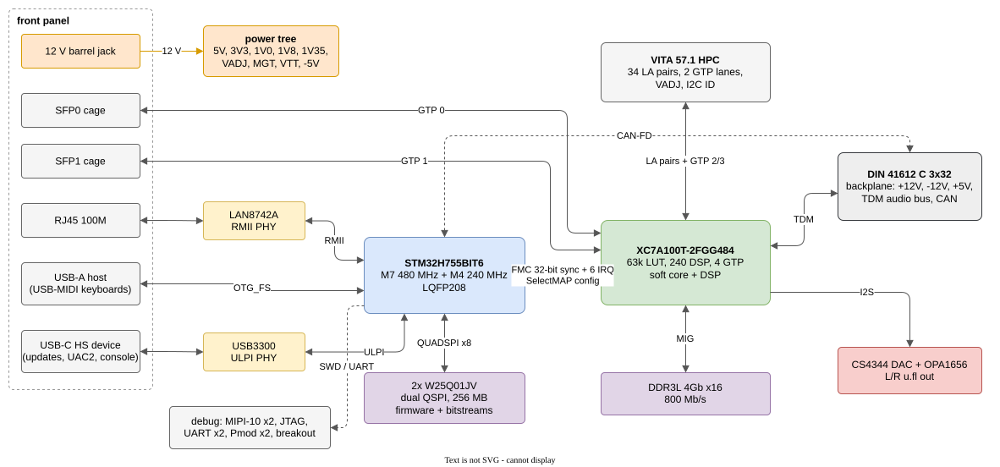

# MAIN_COMPUTE_BOARD v1_r1

General-purpose STM32H7 + Artix-7 compute card in the 3U Eurocard format (160 x 100 mm).
It is the brain for the signalmesh synth: the FPGA does the DSP and drives the on-board DAC,
and it can also drive RF or other front ends through the VITA 57.1 mezzanine.

- [power tree and sequencing](power.md)
- [pin plans: STM32, FPGA banks, connectors](pinout.md)
- [PCB: stackup, impedance, net classes, floorplan, routing status](pcb.md)
- [DDR3 routing: per-net status and finishing guide](ddr_routing.md)
- [routing guide: every open net, grouped in routing order](routing_guide.md)
- FPGA pin constraints for Vivado: `fpga/mcb_pins.xdc` (generated by `gen/xdcgen.py`, with pin-planning checks)
- [bring-up: first power-up, firmware notes](bringup.md)
- [backplane system and Eurorack notes](system.md)
- [performance, clocks and overclocking](performance.md)
- [hardware reference: connectors, headers, buttons, LEDs, test points](hardware.md)

## block diagram

source: [system.drawio](system.drawio) (open in draw.io / diagrams.net to edit)

## key parts

| function | part | notes |
|---|---|---|
| MCU | STM32H755XIH6 (TFBGA265, 14 x 14 mm, 0.8 mm pitch) | LDO supply mode for VOS0 480 MHz. XIH3 is not a substitute (no VOS0) |
| FPGA | XC7A100T-2FGG484I | wire-bond plastic BGA, GTP max 6.25 Gb/s in this package |
| memory | MT41K256M16TW-107 | DDR3L x16, 800 Mb/s with internal VREF, MIG chip select disabled |
| boot/bitstream flash | 2x W25Q01JVZEIQ (WSON-8) | QUADSPI dual-flash, 8-bit, 256 MB memory mapped, shared BK1_NCS. Bottom side, under the STM32 |
| USB HS PHY | USB3300-EZK | ULPI, 24 MHz crystal |
| Ethernet PHY | LAN8742A | RMII, PHY sources the 50 MHz REF_CLK |
| board ID / MAC | 24AA025E48 (U200) | I2C1 at 0x54: factory EUI-48 MAC address plus 128 bytes of user EEPROM |
| audio DAC | CS4344 + OPA1656 | ported from APM v7, -5 V from LM2662 |
| mezzanine | Samtec ASP-134486-01 | VITA 57.1 HPC, LPC cards fit |
| backplane | DIN 41612 C 3x32 male R/A | provisional pinout, see [pinout](pinout.md) |

Sourcing: LCSC had no stock of W25Q01JVZEIQ when it was chosen (Nov 2026); DigiKey stocks the
tray part. Supply it to the assembler if needed. The 1 Gb part was kept over the in-stock
512 Mb W25Q512JVEIQ (same footprint and pinout, half the capacity) for headroom.
