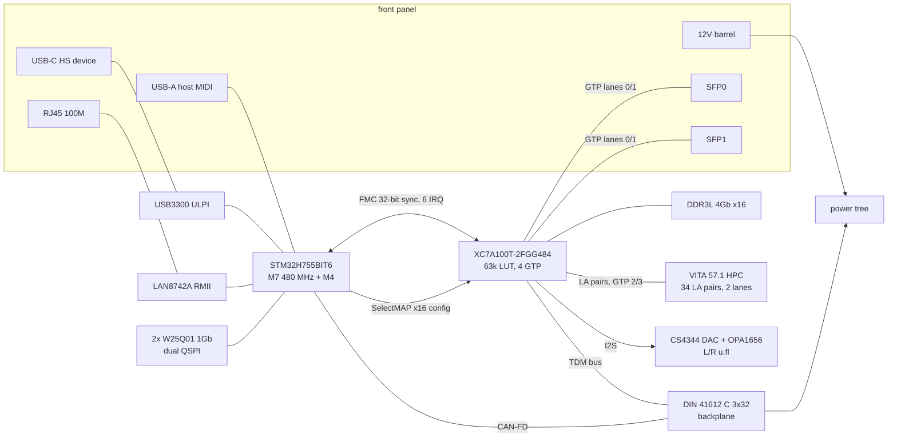

# MAIN_COMPUTE_BOARD v1_r1

General-purpose STM32H7 + Artix-7 compute card in the 3U Eurocard format (160 x 100 mm).
It is the brain for the signalmesh synth: the FPGA does the DSP and drives the on-board DAC,
and it can also drive RF or other front ends through the VITA 57.1 mezzanine.

- [power tree and sequencing](power.md)
- [pin plans: STM32, FPGA banks, connectors](pinout.md)
- [PCB: stackup, impedance, net classes, floorplan](pcb.md)
- [bring-up and firmware notes](bringup.md)

## block diagram

## key parts

| function | part | notes |
|---|---|---|
| MCU | STM32H755BIT6 (LQFP208) | LDO supply mode for VOS0 480 MHz. BIT3 is not a substitute (no VOS0) |
| FPGA | XC7A100T-2FGG484I | wire-bond plastic BGA, GTP max 6.25 Gb/s in this package |
| memory | MT41K256M16TW-107 | DDR3L x16, 800 Mb/s with internal VREF, MIG chip select disabled |
| boot/bitstream flash | 2x W25Q01JVSFIQ | QUADSPI dual-flash, 8-bit, 256 MB memory mapped, shared BK1_NCS |
| USB HS PHY | USB3300-EZK | ULPI, 24 MHz crystal |
| Ethernet PHY | LAN8742A | RMII, PHY sources the 50 MHz REF_CLK |
| audio DAC | CS4344 + OPA1656 | ported from APM v7, -5 V from LM2662 |
| mezzanine | Samtec ASP-134486-01 | VITA 57.1 HPC, LPC cards fit |
| backplane | DIN 41612 C 3x32 male R/A | provisional pinout, see [pinout](pinout.md) |
