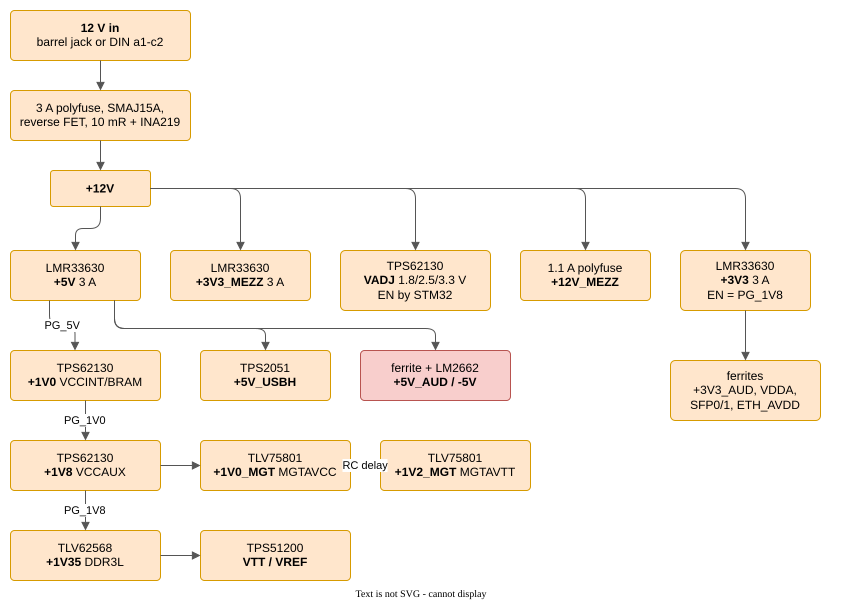

# power tree

12 V comes from the barrel jack or the DIN backplane (same net, use one at a time).
Every rail below is generated on board. Sequencing is automatic and follows the
Artix-7 order in DS181 (VCCINT, VCCBRAM, VCCAUX, VCCO; MGTAVCC before MGTAVTT).

source: [power.drawio](power.drawio)

## rails

| rail | source | enable | consumers | budget (estimate) |
|---|---|---|---|---|
| +12V | input | - | bucks, VITA 12P0V | 2.5 A peak |
| +5V | LMR33630 (400 kHz, 6.8 uH) | 12V UVLO about 9.2 V | 1V0/1V8/1V35 bucks, USB host VBUS, audio | 3 A |
| +3V3_MEZZ | LMR33630 | 12V UVLO | VITA 3P3V (up to 3 A per spec) | 3 A |
| VADJ | TPS62130 from 12V | STM32 via TCA9535 P00 | FPGA banks 16/35, VITA VADJ | 3 A |
| +1V0 | TPS62130 from 5V | PG_5V | VCCINT, VCCBRAM | 1.5-2.5 A |
| +1V8 | TPS62130 from 5V | PG_1V0 | VCCAUX, MGT LDOs, VCCADC | 0.6 A |
| +1V0_MGT | TLV75801 from 1V8 | 1V8 | MGTAVCC | 0.2 A |
| +1V2_MGT | TLV75801 from 1V8 | RC delay after 1V8 | MGTAVTT | 0.3 A |
| +1V35 | TLV62568 from 5V | PG_1V8 | DDR3L VDD/VDDQ, FPGA bank 34 | 0.5 A |
| VTT_DDR / VREF_DDR | TPS51200 | +3V3 | DDR addr/cmd termination | 0.3 A |
| +3V3 | LMR33630 | PG_1V8 | STM32, FPGA banks 0/13/14/15, PHYs, flash, SFPs | 1.5 A |
| +5V_USBH | TPS2051C | STM32 via TCA9535 P12 | USB-A host VBUS | 0.5 A |
| +5V_AUD / -5V | ferrite + LM2662 | - | OPA1656 rails | 50 mA |

## sequencing

1. 12 V rises past about 9.2 V, which enables +5V and +3V3_MEZZ.
2. +5V power-good enables +1V0 (VCCINT and VCCBRAM).
3. +1V0 power-good enables +1V8 (VCCAUX). The MGT LDOs follow 1V8, with MGTAVTT
   held back by an RC so it ramps after MGTAVCC.
4. +1V8 power-good enables +3V3 (all 3.3 V VCCO banks, the STM32) and +1V35.
   This keeps VCCO - VCCAUX inside the 2.625 V / 300 ms DS181 limit.
5. The STM32 boots, reads the mezzanine EEPROM over I2C1, sets VADJ_SEL1:0 and
   enables VADJ, then asserts PG_C2M.

## VADJ select

| VADJ_SEL1 | VADJ_SEL0 | VADJ |
|---|---|---|
| 0 | 0 | 1.8 V (default after reset) |
| 0 | 1 | 2.5 V |
| 1 | 0 | 2.6 V |
| 1 | 1 | 3.3 V |

All four codes are safe for the FPGA. 3.3 V is only valid when the mezzanine does not
need LVDS outputs (Artix-7 HR LVDS outputs need 2.5 V).
