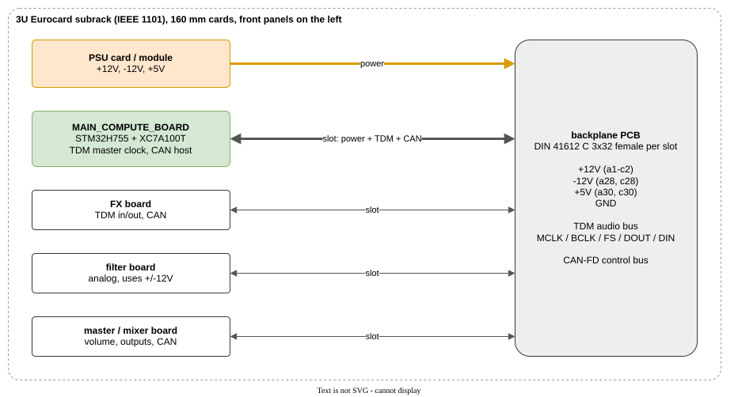

# backplane system and Eurorack notes

source: [backplane.drawio](backplane.drawio)

## Eurocard, not Eurorack

This board is a 3U **Eurocard** (IEC 60297 / IEEE 1101): 100 x 160 mm, slides into card
guides in a 19 inch subrack, and plugs into a backplane through the DIN 41612 connector
on its rear edge. Eurorack (Doepfer A-100) grew out of the same 3U subrack height, so
panel height and rails are shared, but the rest differs:

| | this board (Eurocard) | Eurorack module |
|---|---|---|
| depth | 160 mm card | typical cases 40-90 mm deep |
| power | backplane DIN 41612 (or barrel jack) | 10/16-pin ribbon: +12V, -12V, optional +5V |
| interconnect | backplane buses (TDM audio, CAN) | patch cables (CV, gate, audio) |
| panel | 100 mm front edge, 3U | width in HP (5.08 mm) |

It only fits extra-deep Eurorack cases and has no Eurorack power header, so it is not
Eurorack compatible as built.

## recommended system

A 3U subrack with a custom DIN 41612 backplane, one slot per card:

- **power:** +12V on a1-c2, -12V on a28/c28 and +5V on a30/c30 (analog cards such as
  the filter board need +/-12V), GND on rows 3/32 and the even b pins.
- **audio:** a TDM bus (MCLK, BCLK, FS, DOUT, DIN). The compute board is the clock master,
  so every card runs sample-locked.
- **control:** CAN-FD for presets, parameters and MIDI-style events.

To mix in real Eurorack modules, build a small Eurorack-format bridge module (CV/gate in
and out, ribbon power) cabled to the subrack, or a mezzanine with CV I/O on the VITA site.
